# LEVEL 0

**A first-person multiplayer horror game for the browser, set in the Backrooms.**

Endless yellow rooms, buzzing lights, damp carpet. You see it through the visor of a hazmat suit, everyone plays in the same world, and you are not the only thing in a suit.

**Play it now, free, nothing to install:**

- Own server: **https://backrooms.lou15.com**
- WebSim: **https://websim.com/p/gm719rh51w5sl1sez08a**


No game engine and no build step. The world, the light, every texture and every sound are generated in your browser. The whole game is 3.5 MB.

*Current version: 0.3.0. Every picture on this page was captured from that version.*

## Contents

- [What it is](#what-it-is)
- [The levels](#the-levels)
- [The entities](#the-entities)
- [What you carry](#what-you-carry)
- [Other people](#other-people)
- [Controls](#controls)
- [How it is built](#how-it-is-built)
- [Run it locally](#run-it-locally)
- [Contributing](#contributing)
- [Credits and license](#credits-and-license)

## What it is

You wake up in Level 0. There is no objective marker and nobody tells you where to go. You walk.

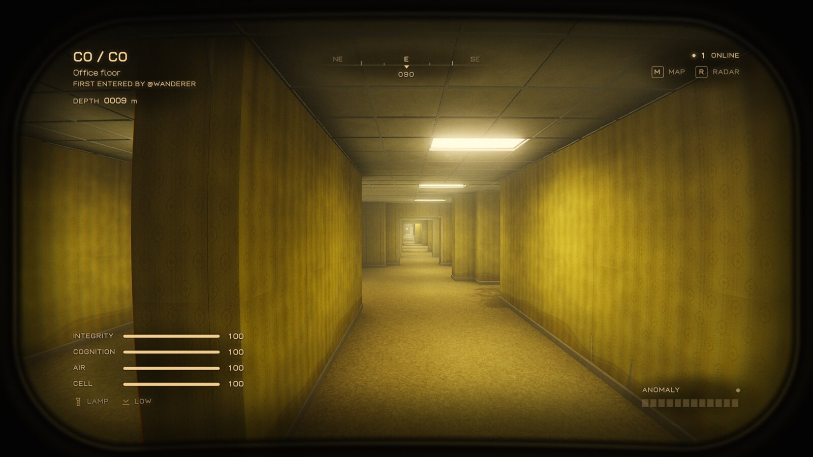

- **One shared world.** It is built from a seed as people walk into it. A sector stays the way it was first found, with the name of whoever got there first, for everyone.
- **It is mostly Level 0.** About nine tenths of the world is the yellow office maze: office floors, partition warrens, pillar halls, sunken courts, mezzanines, dead grids with no power, stairs that go into the ceiling, rooms under the floor. One kind of place runs into the next without a hard line.
- **It is not only Level 0.** Walk far enough and the wallpaper gives way to something else.
- **Nothing happens at the start.** The entry point is safe. What lives here turns up further in, and it picks its moment.
- **There are exits.** They are rare, never close to the entry point, and finding one puts you on the leaderboard.

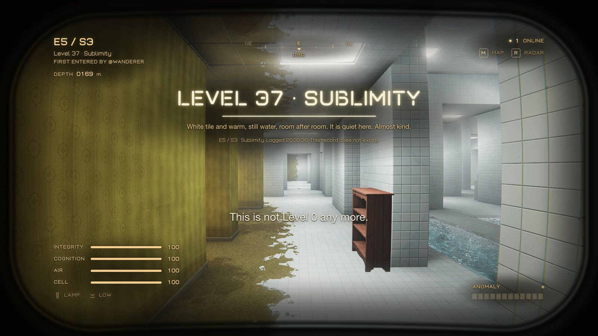

## The levels

The other levels are rare regions far from the entry point. None of them is within about 150 metres of where you start, and you can walk for a long time without seeing one. Each has its own layout, light, fog, sound, footsteps and rules. Every one you enter is written into your Catalog.

<table>
  <tr>
    <td width="50%">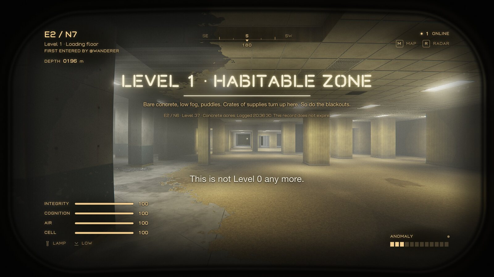<br><b>Level 1 · Habitable Zone</b><br>Bare concrete, low fog, puddles. Crates of supplies turn up here. So do the long blackouts.</td>
    <td width="50%">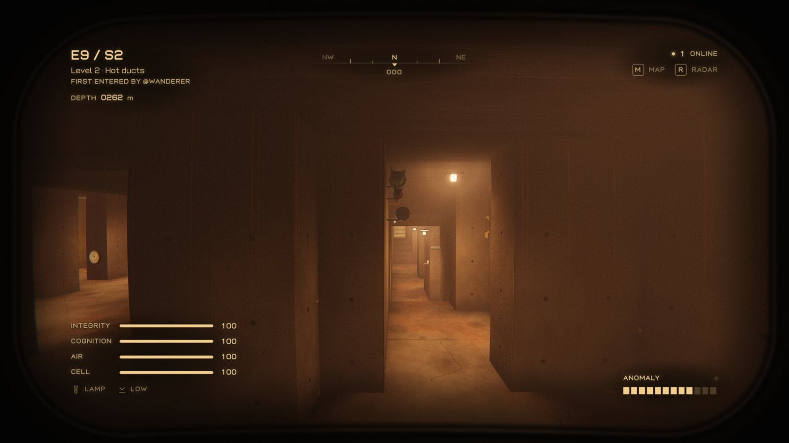<br><b>Level 2 · Pipe Dreams</b><br>Hot service tunnels that never end. Pipes and valves on the walls, very little light, and one of the most dangerous places to be lost.</td>
  </tr>
  <tr>
    <td>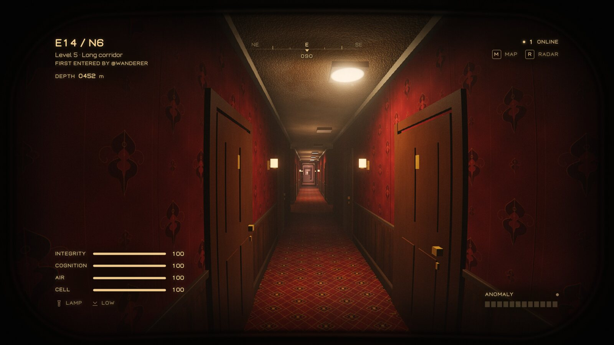<br><b>Level 5 · Terror Hotel</b><br>An old hotel with nobody at the desk. Numbered doors, patterned carpet, wall lamps, a piano somewhere.</td>
    <td>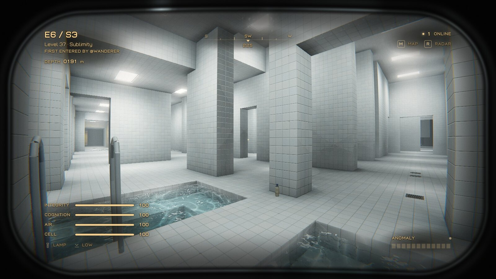<br><b>Level 37 · Sublimity</b><br>White tile and warm, still water, room after room. You wade through the pools. It is the one calm place: almost nothing hunts here, and your head clears while you rest.</td>
  </tr>
  <tr>
    <td>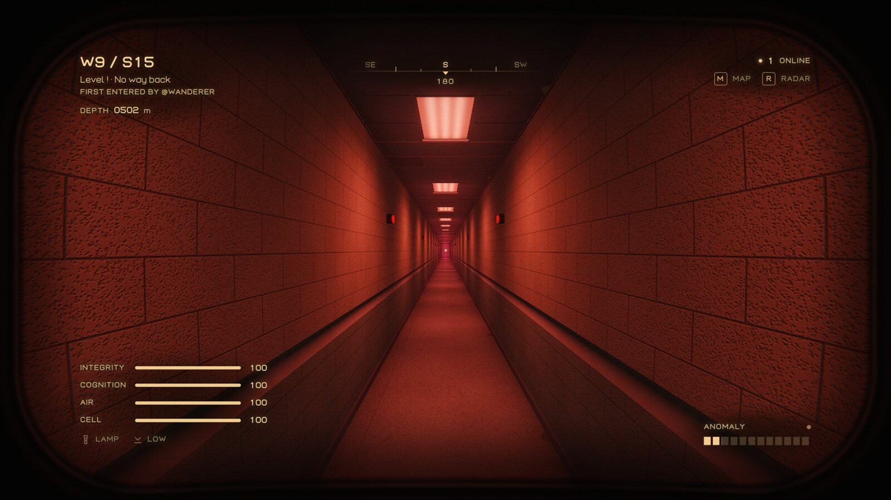<br><b>Level ! · Run For Your Life!</b><br>One sealed corridor, a few hundred metres long. Red lamps, alarms, and a door at the far end.</td>
    <td>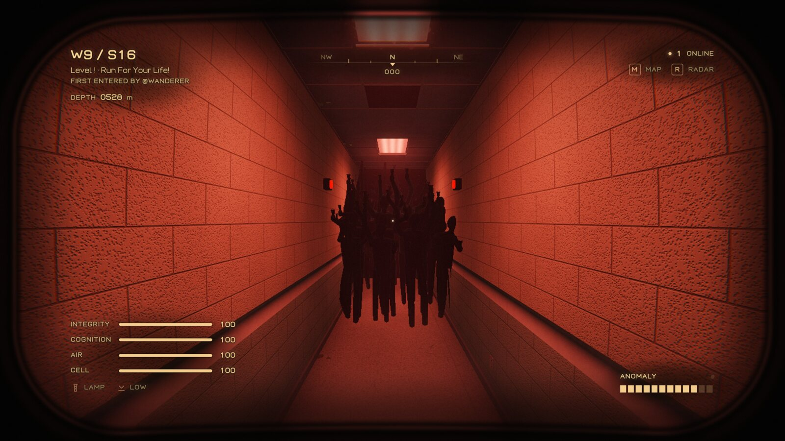<br><b>What is behind you on Level !</b><br>It starts slower than you and keeps getting faster. Hold sprint, do not stop, and do not turn round to take a picture like this one.</td>
  </tr>
</table>

## The entities

Seven of them. Meeting one adds a field note to your Catalog, which is the only place the game explains how to survive it.

<table>
  <tr>
    <td width="33%">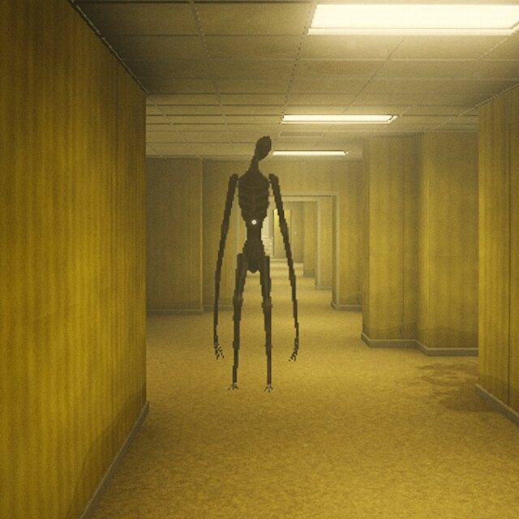<br><b>Howler</b><br>Tall, and it hunts by sound before it hunts by sight. Walk, crouch, break its line of sight and stay quiet.</td>
    <td width="33%">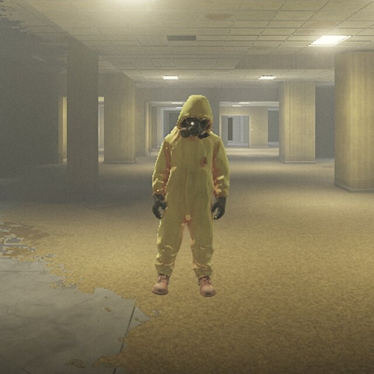<br><b>Hollow</b><br>An empty suit. It only moves when nobody is looking at it. Keep it in view while you leave.</td>
    <td width="33%">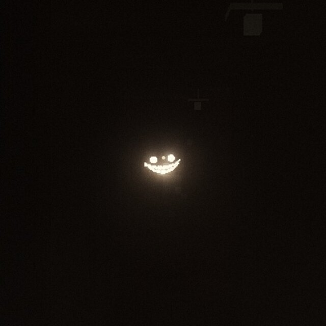<br><b>Smiler</b><br>Teeth and eyes in the dark. Light and running draw it. Hold its gaze and back away slowly.</td>
  </tr>
  <tr>
    <td>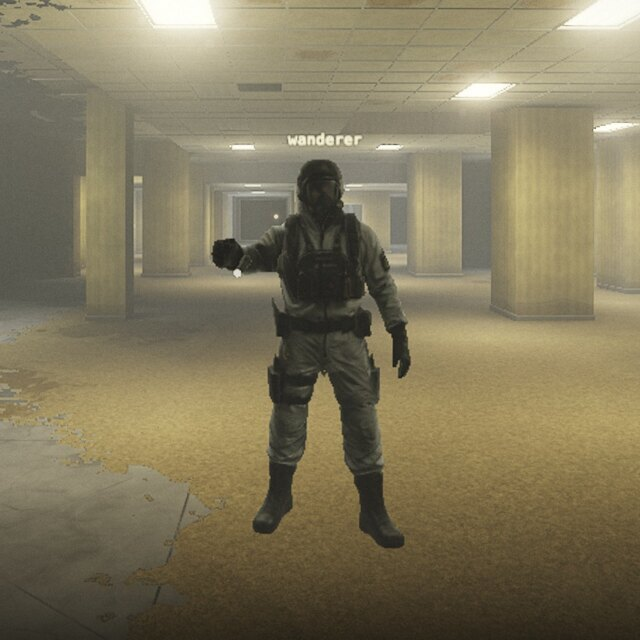<br><b>Skin-Stealer</b><br>It wears a wanderer's suit and a name, sometimes the name of someone who really is nearby, and it waves you over. Look twice before you walk up to a friend.</td>
    <td>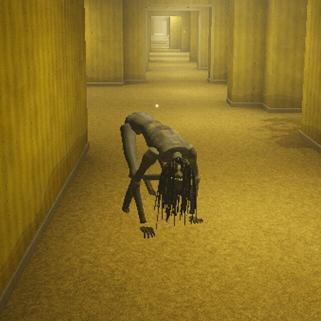<br><b>Hound</b><br>On all fours, and fast. It chases what runs. Face it, stand your ground, back off slowly.</td>
    <td>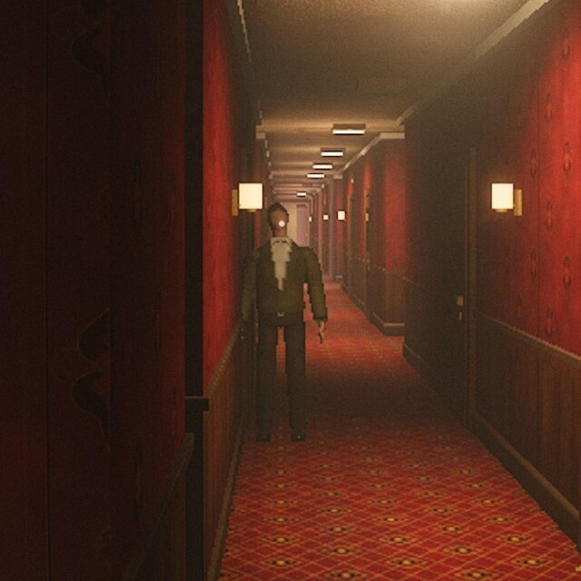<br><b>Faceling</b><br>Someone with no face at the end of the hall. Leave it alone and keep your lamp off it.</td>
  </tr>
</table>

The seventh is the horde, pictured above. It lives on Level ! only.

**They do not come when you expect them.** A director paces every encounter: a long quiet stretch, a build-up of small wrong things, the encounter, then relief.

- Nothing hostile appears within 85 metres of the entry point, or in the first minute and a half of a life.
- The further out you are, and the worse the level, the more there is.
- It prefers the moments your guard is down: the map is open, the radar is out, you are standing still, you are walking back the way you came, or you have just picked something up.
- Some of what you hear and glimpse is a false alarm. Not all of it.

Around all of that the level itself misbehaves: chairs and doors that are there when you look back, writing that was not on the wall a moment ago, lamps that die when something is near, blackouts, voices.

## What you carry

**The suit.** Everything is seen through the visor: the frame, scratches, breath on the plate, cracks when you are hurt. The readout on the inside shows four things. Integrity is your health. Cognition is your sanity, which drains in the dark and near entities and comes back with almond water. Air is your stamina for sprinting. Cell is the flashlight battery.

**The survey (M).** A hand-drawn floor plan of everything that has been walked so far. Yours is in ink, other people's in pencil, with names, chalk signs and bearings. Other levels are washed in their own colour.

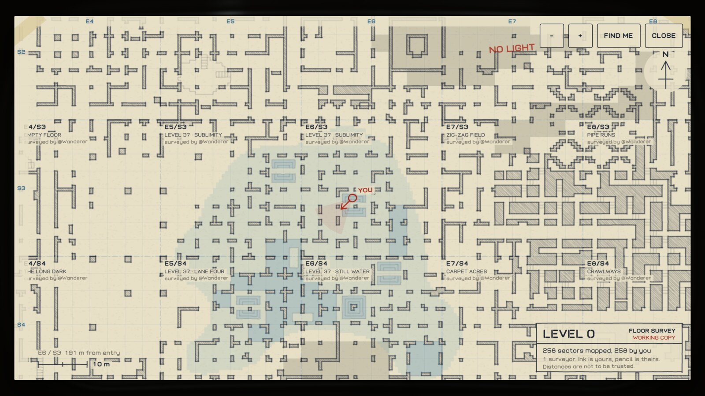

**The handheld (R).** An analog radar and a scrap of the map to carry while you walk. It finds people nearby. It is not always right about who they are.

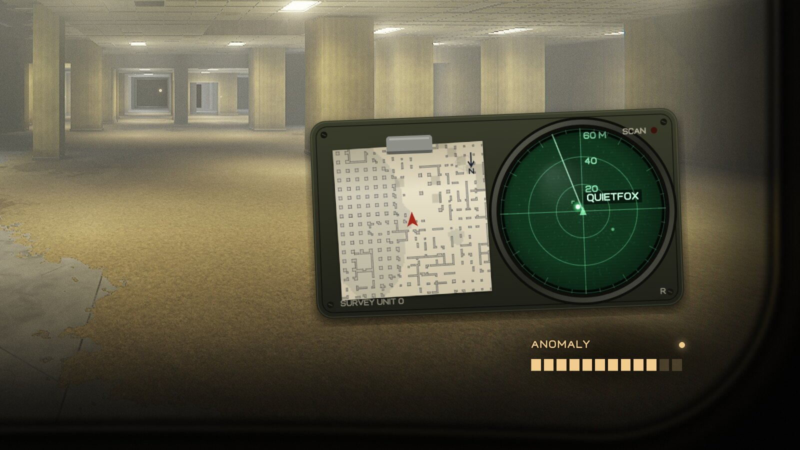

**The Catalog.** Twelve objects to find, a page for every level you have entered and a field note for every entity you have met. Everything else stays redacted until you have seen it yourself.

<p align="center">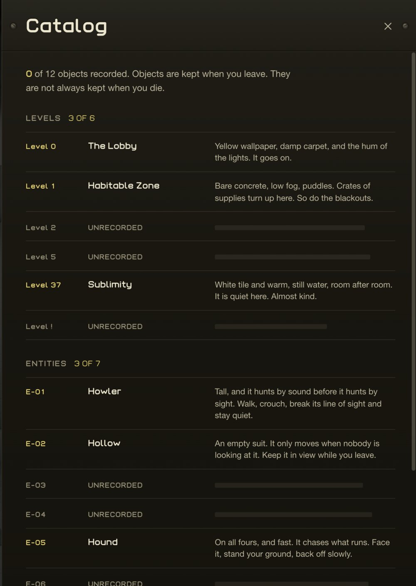</p>

Scattered around the level: almond water, spare cells for the flashlight, and the twelve objects.

## Other people

- You see everyone else's suit and flashlight, live, in the same rooms.
- **Voice:** hold V to talk to people near you. It is opt-in and goes directly between players.
- **Chalk signs:** press Q to leave a sign on the floor for everyone who comes after you.
- **The leaderboard** counts sectors found, objects, escapes and how far out you got.
- **No account.** On the own-server edition you type a name for the suit and that is all. The server keeps that name with the sectors you found, your signs and your stats. On WebSim the game uses your WebSim name.
- If no server can be reached the game still works, alone.

## Controls

| Key | Action |
|---|---|
| W A S D | Move |
| Mouse | Look |
| Shift | Sprint (loud, and it uses air) |
| C or Ctrl | Crouch (quiet) |
| F | Flashlight |
| E | Interact: pick up, drink, leave through a door |
| Q | Leave a chalk sign |
| M | Floor survey (map) |
| R | Handheld radar |
| V | Hold to talk |
| Tab | Players and leaderboard |
| Esc | Pause |

Touch devices get a joystick, drag to look and on-screen buttons. There are three quality levels in Settings; phones start on the lowest.

## How it is built

About 16,500 lines of plain JavaScript modules, [three.js](https://threejs.org) for WebGL, and nothing else. No engine, no bundler, no build step: `dist/` is the game, served as is.

- **World:** sectors of 48 by 48 cells (28.8 m a side) are generated from the world position alone, so two players always build the same room and neighbouring sectors always line up. Each one is checked and repaired so that nothing is sealed off. A test in `tools/` generates a large block of sectors and fails on a mismatch, an unreachable room or a trap.
- **Light:** every ceiling panel is a real light with soft shadows, flicker and bounce, drawn by a custom shader that reads the lamps from data textures.
- **Textures:** wallpaper, carpet, ceiling tiles, concrete, hotel wallpaper, pool tile and the writing on the walls are all painted in code when the game loads.
- **Sound:** every sound is synthesized with WebAudio. There is not one audio file. Each level has its own ambience, reverb and footsteps, and each entity its own voice.
- **Entities:** modelled and animated in code, each with its own brain, on top of one director that decides when anything happens.
- **Multiplayer:** two transports behind one interface. Inside WebSim the game uses WebSim's rooms and database. Anywhere else it talks to a small WebSocket relay (`server/server.mjs`, under 200 lines) that keeps the world in one JSON file. Voice is peer to peer over WebRTC.
- **Files it loads:** its own typeface (Troffer, drawn for the game) and a 1.7 MB pack of 3D models (two suits, an exit door, furniture and fittings), credited in [CREDITS.md](CREDITS.md).

```
dist/                 the whole game, served as is
  index.html
  css/style.css       menus and HUD
  js/main.js          boot, game state, frame loop
  js/biomes.js        the levels and entities table shared by every other file
  js/worldgen.js      sector generator
  js/world.js         streaming, meshing, light maps, collision, pathfinding
  js/shaders.js       lighting, materials, water, visor and lens pass
  js/render.js        HDR target, bloom, final pass
  js/textures.js      every surface, painted at load
  js/player.js        movement and camera
  js/entities.js      other players, the entity brains and the director, anomalies
  js/creatures.js     entity models and their animation
  js/decor.js         level dressing (pipes, hotel doors, pool ladders, alarm lamps)
  js/props.js         models built from primitives, pickups, objects, signs
  js/audio.js         all sound, synthesized with WebAudio
  js/net.js           WebSim, own-server and offline transports behind one interface
  js/voice.js         proximity voice (WebRTC)
  js/map.js           the floor survey (hand-drawn map)
  js/handheld.js      handheld radar and map scrap
  js/assets.js        loader and credits for the model pack
  js/ui.js            menus, HUD, touch controls
  assets/             Troffer typeface, model pack (GLB)
server/server.mjs     WebSocket relay and world store (one JSON file)
deploy/               Cloudflare Worker and systemd unit for backrooms.lou15.com
tools/                font builder (Troffer), model pack builder, world generator test
```

## Run it locally

```bash
# the game (any static file server works)
python3 -m http.server 8790 --directory dist

# the multiplayer server (optional; without it you play alone)
cd server && npm install && npm start
```

Open http://localhost:8790. On localhost the game looks for the server at `ws://localhost:8791`. Add `?offline=1` to skip it, or `?ws=wss://your.host/ws` to point at another one.

Useful while working on it:

- `window.__g` in the browser console is the running game, for example `__g.ents.spawn('K', __g.pl)` to spawn a Hound nearby (codes: `L` Howler, `H` Hollow, `B` Smiler, `M` Skin-Stealer, `K` Hound, `W` Faceling).
- `?place=level37` (or any key from `biomes.js`) dresses the whole world as that level.
- `node tools/worldgen-test.mjs` checks the generator.

## Contributing

Issues and pull requests are welcome. Things that would help most:

- New levels (`biomes.js` is the table to start from), entities and anomalies
- New Level 0 sector types and set pieces in `worldgen.js` (they must keep the edge portals open so neighbours connect)
- Performance on low-end phones
- Sound design passes in `audio.js`

Two rules. Keep `dist/` free of dependencies beyond the vendored three.js. Keep the world deterministic: the same position must always build the same sector, or players stop sharing a world.

## Credits and license

The levels and several of the entities come from the Backrooms, the collaborative fiction written on the Backrooms wikis (CC BY-SA 3.0). Every description in the game is our own wording. The Howler and the Hollow are ours.

MIT for the code, see [LICENSE](LICENSE). three.js is included under its own MIT license. The 3D models in `dist/assets/pack` are CC BY 4.0 by their authors and the Troffer typeface is under the SIL Open Font License 1.1; both are listed in [CREDITS.md](CREDITS.md) and are not covered by the MIT license. The WebSim logo in `dist/assets` belongs to WebSim and is shown in the WebSim edition with their permission; it is not covered by the MIT license.

## Support

If you like it, you can [buy me a pizza](https://www.buymeacoffee.com/louis9987).
