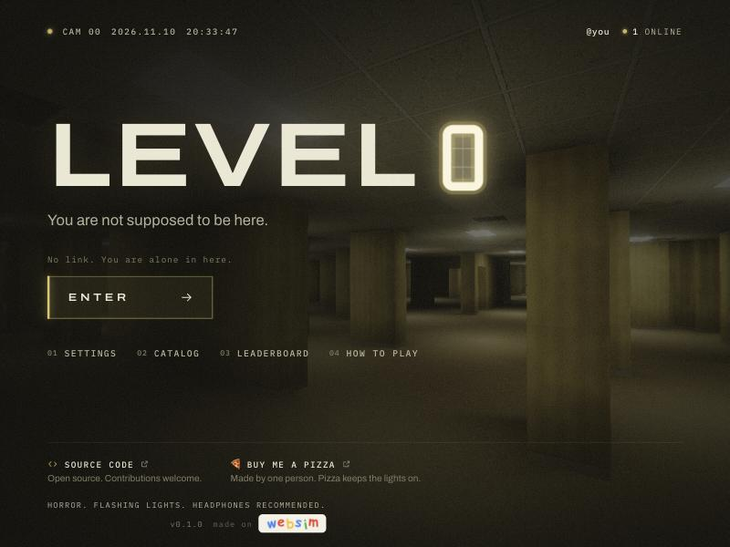
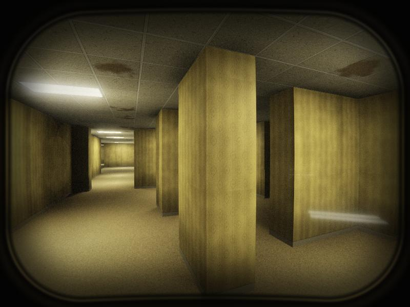
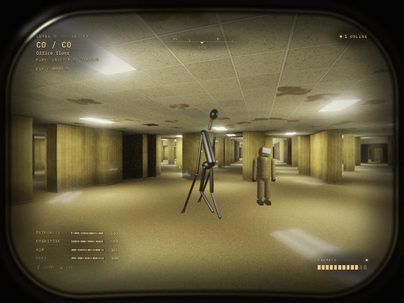

# LEVEL 0

A first-person multiplayer horror game for the browser. Endless yellow rooms, buzzing lights, damp carpet. You see it through the visor of a hazmat suit, and you are not the only thing in a suit.

Everyone plays in the same world. It is generated as people walk into it, and a sector stays the way it was first found, with the name of whoever got there first.

- Play on our own server: https://backrooms.lou15.com
- Play on WebSim: https://websim.com/p/gm719rh51w5sl1sez08a







No build step, no game engine, no image or sound files. Everything you see and hear is generated in the browser.

## What is in it

- **The level**: 28.8 m sectors built from a seed. Office floors, partition warrens, pillar halls, sunken courts, mezzanines, service tunnels, dead grids with no power, stairs that go into the ceiling, rooms under the floor.
- **Light**: every ceiling panel is a real light with soft shadows, flicker and bounce. Some are dying. Some go out when something is near.
- **The suit**: visor frame, scratches, breath on the plate, cracks when you are hurt, a small readout projected on the inside.
- **Things**: a tall one that hunts by sound and sight, an empty suit that only moves when nobody is looking at it, and a patch of dark that eats the lamps.
- **Anomalies**: chairs and doors that are there when you look back, writing that was not on the wall a moment ago, blackouts, voices.
- **Artifacts**: twelve objects to find. The catalog is in the menu.
- **Other people**: you see their suits and their flashlights. Hold V to talk to people near you (opt-in, peer to peer). Press Q to leave a chalk sign on the floor for everyone who comes after you.
- **Exits**: rare, far out. Finding one is recorded on the leaderboard.

## Controls

| | |
|---|---|
| W A S D | Move |
| Mouse | Look |
| Shift | Sprint (loud) |
| C or Ctrl | Crouch |
| F | Flashlight |
| E | Interact |
| Q | Leave a chalk sign |
| V | Hold to talk |
| Tab | Players and leaderboard |
| Esc | Pause |

Touch devices get a joystick, drag to look and on-screen buttons.

## Run it locally

```bash
# the game (any static file server works)
python3 -m http.server 8790 --directory dist

# the multiplayer server (optional; without it you play alone)
cd server && npm install && npm start
```

Open http://localhost:8790. On localhost the game looks for the server at `ws://localhost:8791`. Add `?offline=1` to skip it, or `?ws=wss://your.host/ws` to point at another one.

## Layout

```
dist/                 the whole game, served as is
  index.html
  css/style.css       menus and HUD
  js/main.js          boot, game state, frame loop
  js/worldgen.js      sector generator
  js/world.js         streaming, meshing, light maps, collision, pathfinding
  js/shaders.js       lighting, materials, visor and lens pass
  js/render.js        HDR target, bloom, final pass
  js/textures.js      wallpaper, carpet, ceiling tiles, wall scrawls (all painted at load)
  js/player.js        movement and camera
  js/entities.js      other players, creatures, anomalies
  js/props.js         models built from primitives, pickups, artifacts, signs
  js/audio.js         all sound, synthesized with WebAudio
  js/net.js           WebSim, own-server and offline transports behind one interface
  js/voice.js         proximity voice (WebRTC)
  js/ui.js            menus, HUD, touch controls
server/server.mjs     tiny WebSocket relay and world store (one JSON file)
deploy/               Cloudflare Worker and systemd unit for backrooms.lou15.com
```

Two editions run the same code. Inside WebSim the game uses WebSim's multiplayer rooms and database. Anywhere else it talks to `server/server.mjs`. If neither is reachable it still works, alone.

`window.__g` in the browser console exposes the running game for debugging, for example `__g.ents.spawn('L', __g.pl)`.

## Contributing

Issues and pull requests are welcome. Things that would help most:

- New sector types and set pieces in `worldgen.js` (they must keep the edge portals open so neighbours connect)
- New creatures and anomalies in `entities.js`
- Performance on low-end phones
- Sound design passes in `audio.js`

Keep it dependency-free in `dist/`, and keep the world deterministic: the same seed must always build the same sector, or players stop sharing a world.

## Support

If you like it, you can [buy me a pizza](https://www.buymeacoffee.com/louis9987).

## License

MIT. See [LICENSE](LICENSE). three.js is included under its own MIT license. The WebSim logo in `dist/assets` belongs to WebSim and is shown in the WebSim edition with their permission; it is not covered by the MIT license.
